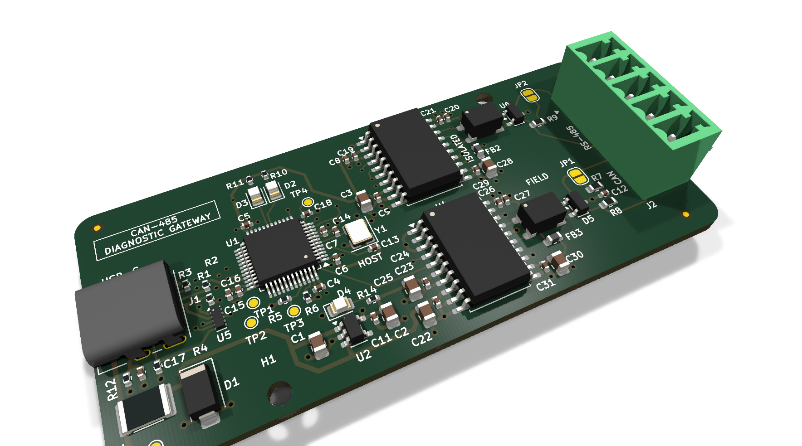
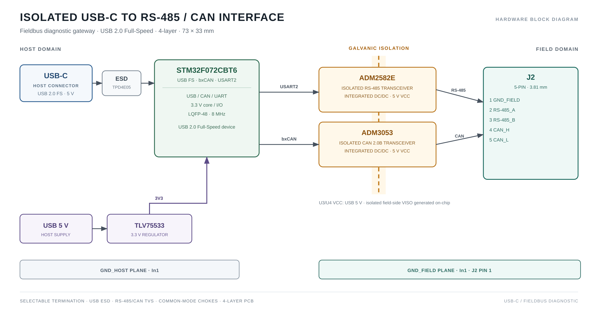
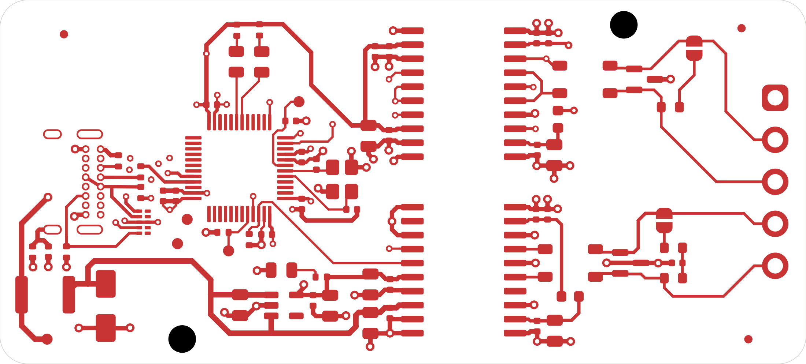
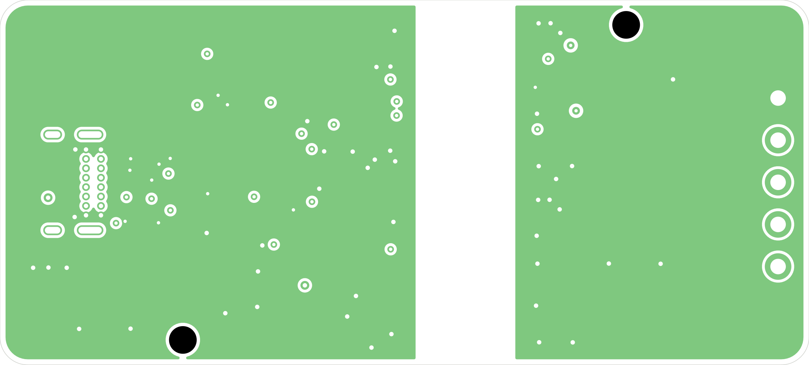
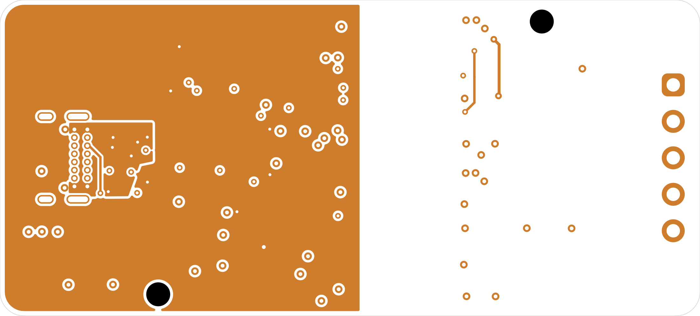
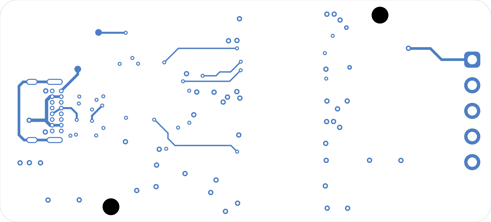

# CAN-485 Diagnostic Gateway — Rev A

An isolated USB-C to **RS-485 / CAN 2.0B** diagnostic dongle for industrial and heavy-machinery bus work.



## Interactive design viewer

| Schematic | PCB |
|:---:|:---:|
| [Open schematic in KiCanvas →][kicanvas-sch] | [Open PCB in KiCanvas →][kicanvas-pcb] |

Read-only browser viewer — no KiCad installation required.

[kicanvas-sch]: https://kicanvas.org/?repo=https%3A%2F%2Fgithub.com%2FMehdi-Ldj%2Fusb-can-rs485-dongle%2Fblob%2Fmain%2Fhardware%2Frev-a%2FCAN485-dongle.kicad_sch
[kicanvas-pcb]: https://kicanvas.org/?repo=https%3A%2F%2Fgithub.com%2FMehdi-Ldj%2Fusb-can-rs485-dongle%2Fblob%2Fmain%2Fhardware%2Frev-a%2FCAN485-dongle.kicad_pcb

## Overview

A laptop connects through USB-C to an **STM32F072CBT6**. The board exposes an isolated
half-duplex RS-485 channel and an isolated CAN 2.0B channel on one 5-pin terminal block.
It is intended for bus diagnostics, protocol work, and field troubleshooting where the
laptop ground must not be tied to machine ground.

This is a PCB-design portfolio repository: schematic, board source, BOM, and renders.

**Firmware will be added later.** This repository currently focuses on the PCB design.

## Features

- USB 2.0 Full-Speed over USB-C
- **STM32F072CBT6** with native USB, bxCAN, and USART2
- **ADM2582E** isolated half-duplex RS-485
- **ADM3053** isolated CAN 2.0B
- Split host/field domains; no copper under the isolators
- Selectable RS-485 and CAN termination
- USB ESD, RS-485/CAN TVS, and common-mode chokes
- **73 × 33 mm, 4-layer** board
- **5-pin 3.81 mm** field terminal: GND, RS-485 A/B, CAN H/L

## Board specifications

| Item | Value |
|---|---|
| Board size | **73 × 33 mm** |
| Layers | **4**, 1.6 mm |
| Host connector | USB-C, left edge |
| Field connector | 5-pin 3.81 mm terminal, right edge |
| MCU | STM32F072CBT6 |
| RS-485 | ADM2582E, isolated, half-duplex |
| CAN | ADM3053, isolated, CAN 2.0B |
| Power | USB 5 V; TLV75533 3.3 V; isolated rails from U3/U4 |
| Planes | Split GND_HOST/GND_FIELD on In1; host +3V3 on In2 |
| Assembly | 31 BOM lines / 62 assembled parts |

## Block diagram



## Copper layers

The assembled top view with silkscreen is [`board-top.png`](docs/renders/board-top.png).
The four copper layers are:

| Layer | Image |
|---|---|
| **F.Cu** | [](docs/renders/1_board-F_Cu.png) |
| **In1.Cu** — split GND_HOST / GND_FIELD | [](docs/renders/2_board-In1_Cu.png) |
| **In2.Cu** — host +3V3 reference | [](docs/renders/3_board-In2_Cu.png) |
| **B.Cu** | [](docs/renders/4_board-B_Cu.png) |

## Field connector pinout

| J2 pin | Signal | Notes |
|---:|---|---|
| 1 | **GND_FIELD** | Isolated field ground |
| 2 | **RS-485_A** | Half-duplex, selectable termination |
| 3 | **RS-485_B** | Half-duplex, selectable termination |
| 4 | **CAN_H** | CAN 2.0B, selectable termination |
| 5 | **CAN_L** | CAN 2.0B, selectable termination |

The terminal block is a board-level connector. For heavy-machinery use, bring it out
through a strain-relieved pigtail or cable gland; it is not an IP-rated field connector.

## Repository structure

```text
usb-can-rs485-dongle/
├── README.md
├── docs/
│   ├── BOM.md
│   └── renders/
│       ├── block-diagram.png
│       ├── board-top.png
│       ├── board-3d-top.png
│       ├── board-3d-iso.png
│       ├── 1_board-F_Cu.png
│       ├── 2_board-In1_Cu.png
│       ├── 3_board-In2_Cu.png
│       ├── 4_board-B_Cu.png
│       └── schematic-rev-a.pdf
└── hardware/
    └── rev-a/
        ├── CAN485-dongle.kicad_pro
        ├── CAN485-dongle.kicad_sch
        ├── CAN485-dongle.kicad_pcb
        ├── CAN485-dongle.kicad_dru
        ├── CAN485-dongle-jlcpcb-bom.csv
        ├── CAN485-dongle.pretty/
        ├── symbols/
        ├── fp-lib-table
        └── sym-lib-table
```

`hardware/rev-a/` is the single canonical board. Intermediate routing copies are
local-only and excluded from the repository.

## BOM

- [`docs/BOM.md`](docs/BOM.md) — readable table
- [`hardware/rev-a/CAN485-dongle-jlcpcb-bom.csv`](hardware/rev-a/CAN485-dongle-jlcpcb-bom.csv) — JLCPCB-format CSV

**31 BOM lines / 62 assembled parts.** Key parts:

| Ref | Part | LCSC |
|---|---|---|
| U1 | STM32F072CBT6 | C81720 |
| U2 | TLV75533PDBVR | C404027 |
| U3 | ADM2582EBRWZ-REEL7 | C39494 |
| U4 | ADM3053BRWZ-REEL7 | C117821 |
| U5 | TPD4E05U06DQAR | C138714 |
| U6 | SM712.TCT | C12067 |
| J1 | USB4085-GF-A | C7095263 |
| J2 | DB2EVC-3.81-5P-GN | C395701 |

H1/H2, fiducials, test points, and solder jumpers are PCB/mechanical features and are
not in the assembly BOM.

## Getting started

1. Install **KiCad 10**.
2. Open `hardware/rev-a/CAN485-dongle.kicad_pro`.
3. Run **DRC** and inspect the board with the project libraries from `hardware/rev-a/`.

## Portfolio scope

The design source, schematic, board, BOM, and renders are included. Manufacturing
outputs — Gerbers, drill files, and CPL — are intentionally **not** part of this
portfolio repository.

## License

License not yet selected. Add one before publishing if this repository is meant to be
reused.
